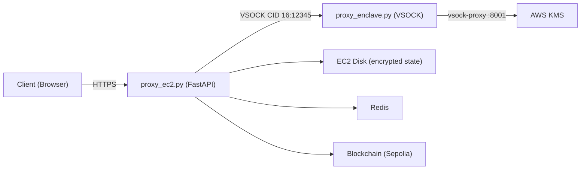

# AWS Nitro Enclave + KMS Deployment Guide

This guide covers deploying the distributed server on an EC2 instance with AWS Nitro Enclaves and configuring KMS for persistent key storage.

---

## Architecture Overview



**Data flow for state persistence:**
1. Enclave calls KMS `GenerateDataKey` → receives plaintext master key + encrypted master key blob
2. Enclave encrypts its in-memory state (user PRE keys) with the master key via AES-GCM
3. EC2 host stores the encrypted master key blob + encrypted state to `enclave_storage/` on disk
4. On restart, EC2 sends both blobs back to enclave → enclave calls KMS `Decrypt` to recover the master key → decrypts state

---

## Prerequisites

- **EC2 Instance**: Must be an [enclave-enabled instance type](https://docs.aws.amazon.com/enclaves/latest/user/nitro-enclave.html) (e.g. `m5.xlarge`, `c5.2xlarge`, `r5.xlarge`)
  - Minimum 4 vCPUs (2 reserved for enclave)
  - Minimum 4 GiB RAM (2048 MiB reserved for enclave)
- **Amazon Linux 2** or **Amazon Linux 2023** on the EC2 host
- **Docker** installed on the host
- **Nitro CLI** installed (`aws-nitro-enclaves-cli`)
- **IAM Role** attached to the EC2 instance

---

## Step 1: EC2 Instance Setup

### 1.1 Launch an Enclave-Enabled Instance

When launching via the AWS Console or CLI, enable enclave support:

```bash
aws ec2 run-instances \
  --instance-type m5.xlarge \
  --enclave-options 'Enabled=true' \
  --image-id ami-xxxxxxxxx \
  --iam-instance-profile Name=NitroEnclaveRole \
  --key-name your-key-pair \
  --security-group-ids sg-xxxxxxxx
```

### 1.2 Install Dependencies on EC2 Host

```bash
# Install Nitro Enclaves CLI and allocator
sudo amazon-linux-extras install aws-nitro-enclaves-cli -y
sudo yum install aws-nitro-enclaves-cli-devel -y

# Add your user to the ne and docker groups
sudo usermod -aG ne ec2-user
sudo usermod -aG docker ec2-user

# Configure enclave resources
sudo vi /etc/nitro_enclaves/allocator.yaml
```

Set the allocator config:
```yaml
# /etc/nitro_enclaves/allocator.yaml
memory_mib: 2048
cpu_count: 2
```

```bash
# Start and enable services
sudo systemctl enable --now nitro-enclaves-allocator.service
sudo systemctl enable --now docker

# Log out and back in for group changes
exit
```

### 1.3 Install Application Dependencies

```bash
# Install Python and Redis
# Amazon Linux 2023:
sudo dnf install python3.11 redis -y
sudo systemctl enable --now redis

# Amazon Linux 2 (alternative):
# sudo amazon-linux-extras install redis6 -y
# sudo systemctl enable --now redis

pip3.11 install -r requirements.txt
```

---

## Step 2: Create the KMS Key

### 2.1 Create a Symmetric KMS Key

```bash
aws kms create-key \
  --description "Nitro Enclave master key for distributed-data-management" \
  --key-usage ENCRYPT_DECRYPT \
  --key-spec SYMMETRIC_DEFAULT \
  --region eu-west-2
```

Save the output `KeyId` (e.g. `arn:aws:kms:eu-west-2:123456789012:key/abcd1234-...`).

### 2.2 Create an Alias (Optional but Recommended)

```bash
aws kms create-alias \
  --alias-name alias/nitro-enclave-master-key \
  --target-key-id <KeyId-from-above> \
  --region eu-west-2
```

---

## Step 3: Build the Enclave and Get PCR0

### 3.1 Build the Enclave Image

Transfer the `distributed-server/` directory to your EC2 instance, then:

```bash
cd distributed-server
chmod +x build_enclave.sh
./build_enclave.sh
```

This runs two steps:
1. `docker build` — compiles `kmstool_enclave_cli` and packages `proxy_enclave.py`
2. `nitro-cli build-enclave` — converts the Docker image into an EIF (`proxy-enclave.eif`)

### 3.2 Record the PCR0 Value

The build output will print something like:

```
{
  "Measurements": {
    "HashAlgorithm": "Sha384 { ... }",
    "PCR0": "abc123def456...7890",
    "PCR1": "...",
    "PCR2": "..."
  }
}
```

**Copy the `PCR0` value** — you need it for the KMS key policy in the next step.

> [!IMPORTANT]
> PCR0 changes every time you rebuild the enclave image. If you update `proxy_enclave.py` or `Dockerfile.enclave` and rebuild, you must update the KMS key policy with the new PCR0.

---

## Step 4: Configure the KMS Key Policy

### 4.1 Get the EC2 Instance Role ARN

```bash
# On the EC2 instance
curl -s http://169.254.169.254/latest/meta-data/iam/info | jq -r '.InstanceProfileArn'
```

The role ARN will look like: `arn:aws:iam::123456789012:role/NitroEnclaveRole`

### 4.2 Set the Key Policy

Replace the placeholders and apply:

```bash
aws kms put-key-policy \
  --key-id <your-kms-key-id> \
  --policy-name default \
  --policy '{
    "Version": "2012-10-17",
    "Id": "nitro-enclave-kms-policy",
    "Statement": [
      {
        "Sid": "AllowRootAccountFullAccess",
        "Effect": "Allow",
        "Principal": {
          "AWS": "arn:aws:iam::<ACCOUNT_ID>:root"
        },
        "Action": "kms:*",
        "Resource": "*"
      },
      {
        "Sid": "AllowEnclaveDecryptAndGenerateDataKey",
        "Effect": "Allow",
        "Principal": {
          "AWS": "arn:aws:iam::<ACCOUNT_ID>:role/<EC2_ROLE_NAME>"
        },
        "Action": [
          "kms:Decrypt",
          "kms:GenerateDataKey"
        ],
        "Resource": "*",
        "Condition": {
          "StringEqualsIgnoreCase": {
            "kms:RecipientAttestation:ImageSha384": "<PCR0_VALUE_FROM_BUILD>"
          }
        }
      }
    ]
  }' \
  --region eu-west-2
```

> [!CAUTION]
> - The `AllowRootAccountFullAccess` statement is required so you don't lock yourself out of the key.
> - The `kms:RecipientAttestation:ImageSha384` condition ensures **only your specific enclave image** can use this key. No other process — not even the EC2 host — can decrypt with it.

### 4.3 Attach IAM Policy to the EC2 Role

The EC2 instance role also needs permission to call KMS:

```json
{
  "Version": "2012-10-17",
  "Statement": [
    {
      "Effect": "Allow",
      "Action": [
        "kms:Decrypt",
        "kms:GenerateDataKey"
      ],
      "Resource": "arn:aws:kms:eu-west-2:<ACCOUNT_ID>:key/<KEY_ID>"
    }
  ]
}
```

```bash
aws iam put-role-policy \
  --role-name <EC2_ROLE_NAME> \
  --policy-name NitroEnclaveKMSAccess \
  --policy-document file://kms-iam-policy.json
```

---

## Step 5: Configure Environment Variables

Edit `.env.local` on the EC2 host:

```bash
# .env.local
CONTRACT_ADDRESS=0x032cB009F18a785FEB480dcf8cbE79105B4DDbD6
RPC_URL=https://eth-sepolia.g.alchemy.com/v2/<your-key>
REDIS_URL=redis://localhost:6379
AWS_REGION=eu-west-2
KMS_KEY_ID=arn:aws:kms:eu-west-2:<ACCOUNT_ID>:key/<KEY_ID>
IS_LOCAL_ENV=
ALLOWED_ORIGINS=https://your-client-domain.com
```

> [!IMPORTANT]
> `KMS_KEY_ID` must be the full ARN of the key, not just the alias.
> `IS_LOCAL_ENV` must be empty or unset for production (this switches VSOCK vs TCP and enables KMS).

---

## Step 6: Launch the System

### 6.1 Start the VSOCK Proxy

The enclave has no direct network access. The `vsock-proxy` bridges the enclave to KMS via the host:

```bash
vsock-proxy 8001 kms.eu-west-2.amazonaws.com 443 &
```

This maps:
- Enclave VSOCK port `8001` → `kms.eu-west-2.amazonaws.com:443`

The port `8001` matches `KMS_PROXY_PORT` in `proxy_enclave.py`.

### 6.2 Run the Enclave

```bash
nitro-cli run-enclave \
  --cpu-count 2 \
  --memory 2048 \
  --eif-path proxy-enclave.eif \
  --enclave-cid 16
```

Verify it's running:
```bash
nitro-cli describe-enclaves
```

### 6.3 Start the EC2 Proxy Server

```bash
cd distributed-server
uvicorn proxy_ec2:app --host 0.0.0.0 --port 8000
```

On startup, `proxy_ec2.py` will:
1. Load `enclave_storage/encrypted_master_key.bin` and `encrypted_state.bin` (if they exist)
2. Send an `init` action to the enclave via VSOCK
3. The enclave calls KMS to either generate a new master key or decrypt the existing one
4. Begin listening for blockchain events and client requests

---

## Step 7: Verify the Deployment

### 7.1 Check Enclave Logs

```bash
nitro-cli console --enclave-id $(nitro-cli describe-enclaves | jq -r '.[0].EnclaveID')
```

You should see:
```
Enclave server running on VSOCK port 12345
```

### 7.2 Test the Init Flow

If this is a fresh deployment (no `enclave_storage/` files), the EC2 proxy logs should show:

```
[EC2] No persisted state, initializing new enclave...
[EC2] Enclave initialized successfully
```

The enclave will have called `kmstool_enclave_cli genkey` to create a new master key.

### 7.3 Test State Persistence

After a user registers (via SIWE login), the enclave state is encrypted and saved. You can verify:

```bash
ls -la enclave_storage/
# Should show:
# encrypted_master_key.bin
# encrypted_state.bin
```

If you restart the enclave, the state should restore automatically:
```
[EC2] Found persisted state, restoring enclave...
[ENCLAVE] State restored successfully.
```

---

## Operational Notes

### Rebuilding the Enclave

After any code change to `proxy_enclave.py`:

1. Rebuild: `./build_enclave.sh`
2. Copy the new PCR0 value
3. Update the KMS key policy with the new PCR0
4. Terminate old enclave: `nitro-cli terminate-enclave --all`
5. Re-run the enclave

### Security Model

| Component | Access to Plaintext Keys? |
|---|---|
| EC2 Host (`proxy_ec2.py`) | **No** — only handles encrypted blobs |
| Enclave (`proxy_enclave.py`) | **Yes** — holds master key and user PRE keys in sealed memory |
| KMS | **No** — only releases keys when attestation matches PCR0 |
| Disk (`enclave_storage/`) | **No** — stores AES-GCM encrypted ciphertext only |

### Debugging KMS Errors

| Error | Cause |
|---|---|
| `AccessDeniedException` | KMS key policy doesn't include the EC2 role, or PCR0 mismatch |
| `KMS Decrypt Error` | `vsock-proxy` not running, or wrong region |
| `No plaintext found in kmstool output` | `kmstool_enclave_cli` returned unexpected format |
| `AF_VSOCK not available` | Not running inside a Nitro Enclave |
